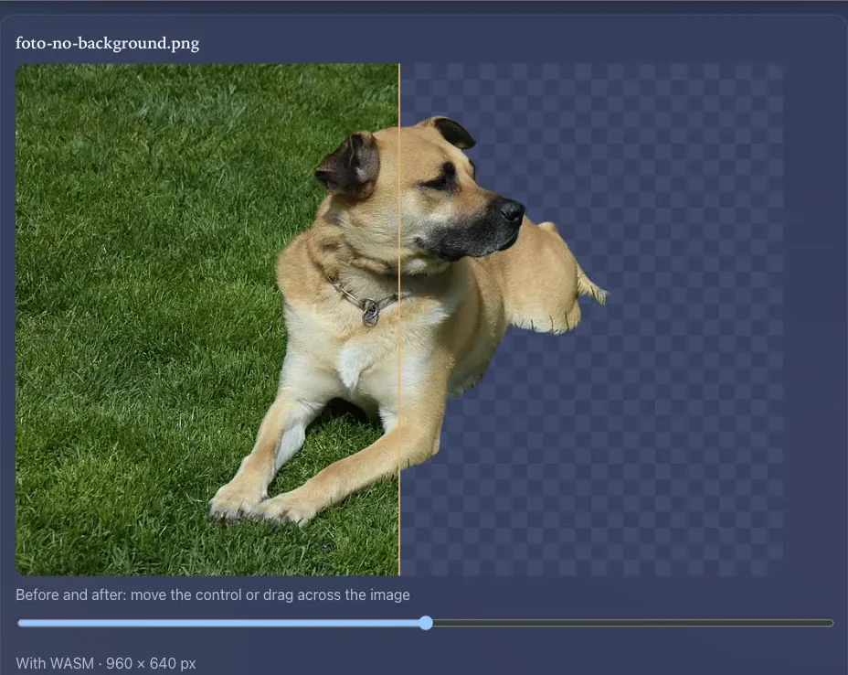
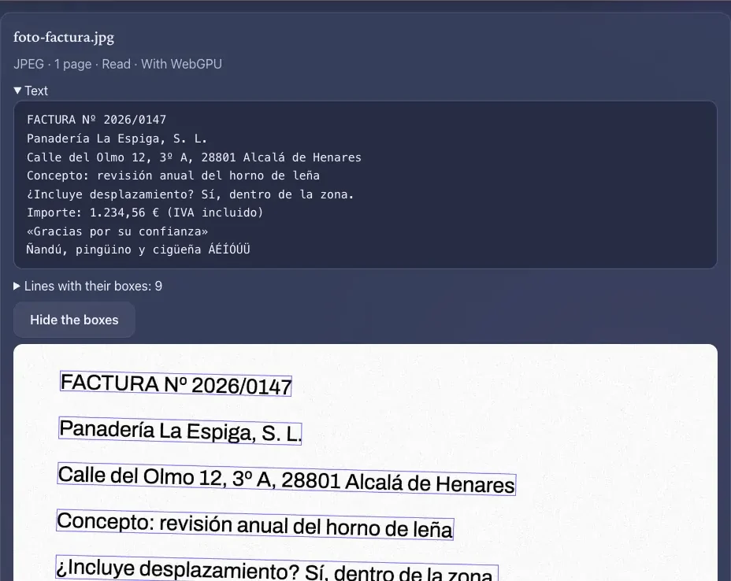
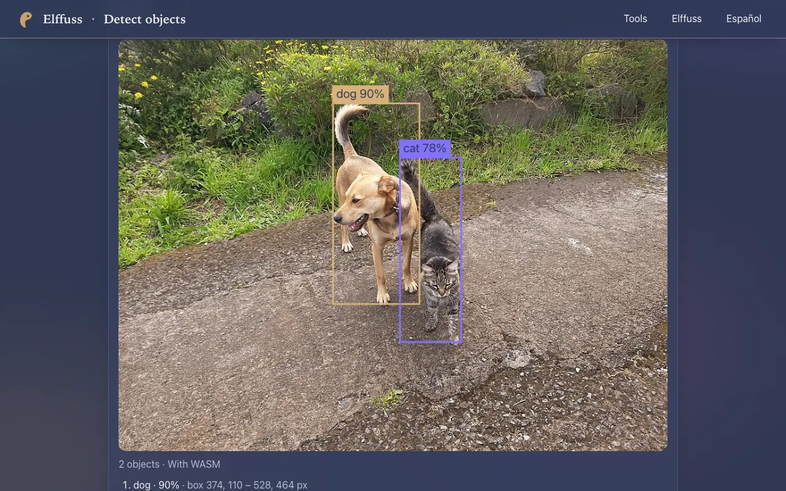
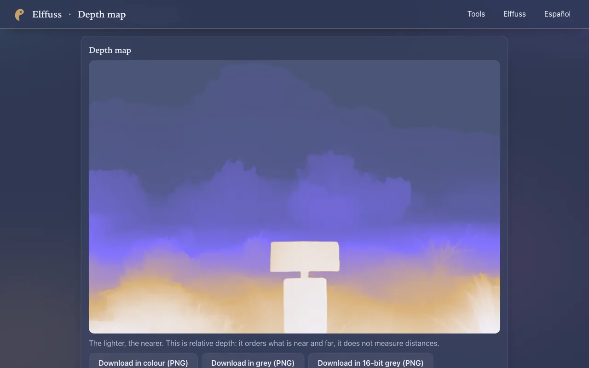
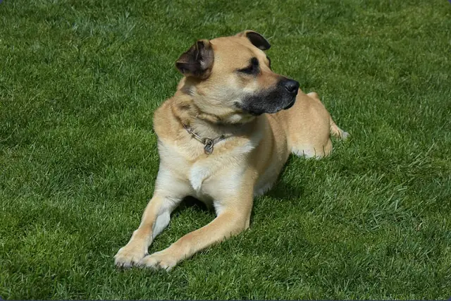
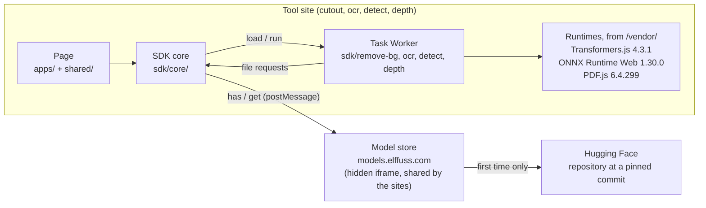

<p align="center">
  
</p>

<h1 align="center">Elffuss AI</h1>

<p align="center">
  Small AI tools that run their model in your browser, with WebGPU or WebAssembly,<br>
  and the plain JavaScript modules they are built on.
</p>

<p align="center">
  <a href="LICENSE"></a>
  <a href="https://tools.elffuss.com/en/"></a>
</p>

<table>
  <tr>
    <td width="50%"><a href="https://cutout.elffuss.com/en/"></a></td>
    <td width="50%"><a href="https://ocr.elffuss.com/en/"></a></td>
  </tr>
  <tr>
    <td align="center"><b>Remove background</b></td>
    <td align="center"><b>Read text</b></td>
  </tr>
  <tr>
    <td width="50%"><a href="https://detect.elffuss.com/en/"></a></td>
    <td width="50%"><a href="https://depth.elffuss.com/en/"></a></td>
  </tr>
  <tr>
    <td align="center"><b>Detect objects</b></td>
    <td align="center"><b>Depth map</b></td>
  </tr>
</table>

Each tool is a static site. It downloads its model once, from the model's own
Hugging Face repository at a pinned revision, keeps it in the browser, and runs
it there. The photos, scans and PDFs you open are never uploaded.

The first time, one click does it all: the button names the action and the
exact download size, then downloads the model and runs it. After that, choosing,
dropping or pasting a file runs it at once, with no click.

<p align="center">
  
</p>

The screenshots are from the live sites, running the real models on CC0 photos
from Wikimedia Commons and on an invoice drawn by `scripts/make-fixtures.mjs`
(sources in `tests/fixtures/SOURCES.json`).

## Try it

| Site | What it does | Model (licence) | Backends |
|---|---|---|---|
| [cutout.elffuss.com](https://cutout.elffuss.com/en/) | Remove the background, as a transparent PNG, with a before and after view | BEN2 by PramaLLC (MIT) | WebAssembly |
| [ocr.elffuss.com](https://ocr.elffuss.com/en/) | Read the text of photos, scans and PDFs, even whole folders; export as Markdown, JSON or ZIP | PP-OCRv6 small by PaddlePaddle (Apache-2.0) | WebGPU or WebAssembly |
| [detect.elffuss.com](https://detect.elffuss.com/en/) | Find up to 80 kinds of objects, in a photo or with the camera | RF-DETR Nano by Roboflow (Apache-2.0) | WebAssembly |
| [depth.elffuss.com](https://depth.elffuss.com/en/) | Work out what is near and what is far, with a colour map, a 3D view and 16-bit PNG | Depth Anything V2 Small by depth-anything (Apache-2.0) | WebGPU or WebAssembly |
| [tools.elffuss.com](https://tools.elffuss.com/en/) | The catalog of every Elffuss tool | none | none |

Every site is in Spanish at its root and in English under `/en/`.

## What stays on your device

- **Your files.** Images, PDFs and camera frames are read and processed in the
  page and its Worker. The page's Content Security Policy only lets it connect
  to its own origin (`connect-src 'self'`) and only lets it embed the model
  store, which accepts nothing from the sites but requests for model files.
  There is no analytics script.
- **What is downloaded.** The model, from its Hugging Face repository at a
  pinned commit, through the Elffuss model store; and the code and runtimes,
  from the site itself. Nothing is loaded from a CDN.
- **What is kept.** The model files, in the browser storage of the model store
  (`models.elffuss.com`), shared by the Elffuss sites so a model is downloaded
  once. Each site's "Storage" panel lists them.

The longer version is on [elffuss.com/how-it-works](https://elffuss.com/how-it-works/#tools).

## Use the modules in your page

The modules are plain ES modules with no build step and no dependencies. The
package is **not on npm**: use it from this repository. The SDK starts its model
Worker only from same-origin URLs under `/v/` or `/vendor/`, so the simplest
way is to let the build lay out one tool's files and put your page next to them.

```bash
git clone https://github.com/utopia-ia/elffuss-ai.git
cd elffuss-ai
# writes dist/detect/v/dev/ (SDK, registry) and dist/detect/vendor/ (runtimes)
node scripts/build.mjs detect --dev --out dist
```

Save this as `dist/detect/my-page.html`:

```html
<!doctype html>
<meta charset="utf-8">
<input type="file" id="file" accept="image/*">
<pre id="out"></pre>
<script type="module">
  import { Detect } from '/v/dev/sdk/detect/index.js';

  const out = document.getElementById('out');
  const detector = new Detect({
    onProgress: p => { out.textContent = `${p.status} ${p.loaded ?? ''} / ${p.total ?? ''}`; },
  });

  document.getElementById('file').addEventListener('change', async e => {
    const file = e.target.files[0];
    const { objects, device } = await detector.run(file, { threshold: 0.5 });
    const lines = objects.map(o => `${o.label} ${o.score.toFixed(2)}`);
    out.textContent = [device, ...lines].join('\n');
  });
</script>
```

Serve the folder and open `http://localhost:8800/my-page.html`:

```bash
cd dist/detect && python3 -m http.server 8800 --bind 127.0.0.1
```

With `tests/fixtures/detect/foto.jpg` it prints `wasm`, `dog 0.90` and
`cat 0.78`. The first run downloads the model (29 MB) through the model store;
later runs take it from the browser.

The other tasks work the same way (`node scripts/build.mjs <cutout|ocr|depth> --dev --out dist`):

```js
// run() gives { png, alpha, width, height, device, … }
import { RemoveBg } from '/v/dev/sdk/remove-bg/index.js';
import { Depth } from '/v/dev/sdk/depth/index.js';
import { Ocr } from '/v/dev/sdk/ocr/index.js';
```

Each task class has `load()`, `run(input, options)` and `dispose()`, and a
one-call form (`removeBg`, `detect`, …) that loads, runs once and releases the
model. Errors are `AiError`s with a stable `code` (`store-unavailable`,
`webgpu-unavailable`, `too-large`, `aborted`, …). `device: 'auto'` takes WebGPU
when the model has a WebGPU variant and the browser has a real adapter, else
WebAssembly; an explicit `'webgpu'` or `'wasm'` is never swapped. A `store`
option replaces the Elffuss model store with any object that has
`has(url, bytes)` and `get(url, { bytes, signal, onProgress })`. The full API is
in [docs/api](docs/api/).

## How it works



1. The page embeds the model store as a hidden iframe and asks which files of
   the model this browser already has (`has`). The primary button says what it
   will download and its size; the first time, one click downloads and runs.
   Once the model is here, choosing an input runs it with no click.
2. The task's Worker asks for each file at its pinned URL and exact size
   (`get`), through the page. The store downloads only what it lacks and keeps
   it in its own storage.
3. The SDK checks every file's hash against `registry/tasks.json` (the first
   time in each browser), checks the runtime versions against their pins, and
   creates the session on the backend the registry allows for this browser.
   It never switches backend on its own; a site may retry once on WebAssembly
   and says so.
4. Requests the runtime makes for model files are answered from the pinned
   commit, so the page itself never talks to Hugging Face. Trusted Types are
   required.

The sites cannot empty the store, save files into it or list it: the store only
accepts from them the files of `registry/tasks.json`, each at its pinned URL and
exact size (`node scripts/broker-repos.mjs` prints that list).

## Modules

<!-- modules:start -->
| Module | What it does | Site | Status |
|---|---|---|---|
| `@elffuss/ai/core` | Model store client, backend choice, pinned runtimes, registry, Worker host, errors, progress | every site | in use |
| `@elffuss/ai/remove-bg` | Remove the background of an image (transparent PNG) | [cutout.elffuss.com](https://cutout.elffuss.com/) | in use |
| `@elffuss/ai/depth` | Depth map of a photo | [depth.elffuss.com](https://depth.elffuss.com/) | in use |
| `@elffuss/ai/detect` | Object detection, 80 COCO classes | [detect.elffuss.com](https://detect.elffuss.com/) | in use |
| `@elffuss/ai/ocr` | Text from images and PDFs | [ocr.elffuss.com](https://ocr.elffuss.com/) | in use |
<!-- modules:end -->

Each task module also exports `<task>/sizes`, the download size of each of its
variants. The names are the `exports` of `package.json`; from a clone, import
the files under `sdk/` as shown above.

## Models and licences

| Task | Model | Author | Licence | Download, the first time |
|---|---|---|---|---|
| remove-bg | [BEN2](https://huggingface.co/PramaLLC/BEN2) | PramaLLC | MIT | 219 MB (WebAssembly, fp16) |
| ocr | [PP-OCRv6 small](https://github.com/PaddlePaddle/PaddleOCR) | PaddlePaddle | Apache-2.0 | 31 MB (WebGPU or WebAssembly, fp32) |
| detect | [RF-DETR Nano](https://github.com/roboflow/rf-detr) | Roboflow | Apache-2.0 | 29 MB (WebAssembly, q8) |
| depth | [Depth Anything V2 Small](https://huggingface.co/depth-anything/Depth-Anything-V2-Small) | depth-anything | Apache-2.0 | 50 or 99 MB (WebGPU, fp16 or fp32), 27 MB (WebAssembly, q8) |

The weights are ONNX exports from `onnx-community` and `PaddlePaddle` on Hugging
Face. They are not part of this repository and are not redistributed.
[docs/MODELS.md](docs/MODELS.md) gives every repository, pinned commit and file.

## Repository

| Path | What it holds |
|---|---|
| `sdk/core/` | The shared core: store client, backend choice, registry, pinned runtimes, Worker host, errors, progress, Trusted Types, ZIP writer |
| `sdk/<task>/` | One module per task (`sizes.js` is generated from the registry) |
| `registry/` | `source.mjs` (written by hand) and `tasks.json` (generated from the Hub API) |
| `vendor/` | The runtimes, byte for byte, pinned in `vendor/manifest.json` |
| `apps/<site>/` | Each tool site: descriptor, texts, page, script |
| `catalog/` | The `tools.elffuss.com` catalog |
| `shared/` | The page template, layout CSS, colour variables, the Elffuss mark and the page shell |
| `deploy/` | Headers and CSP (one source), generated nginx vhosts, deploy scripts, `DEPLOY.md` |
| `scripts/` | Build, registry, vendor, weights for tests, docs, publication sweep |
| `tests/unit/`, `tests/browser/` | Node tests; the browser harness and its specs |
| `docs/` | Generated API reference, models, `llms.txt`, the site contract, images |

## Development

Node 22 or later. No `npm install`: there are no dependencies.

```bash
node --test "tests/unit/*.test.mjs"                          # no network, no browser
node scripts/build.mjs all --channel test --dev --out <dir>  # build every site locally
node scripts/build-docs.mjs --check                          # generated docs match the code
```

The browser tests serve each site from its own local origin with its real
headers, serve a local model store, answer Hugging Face from a local weight
cache, and run in Chrome twice: with WebGPU (after checking for a real adapter)
and with WebGPU removed. They need Playwright from any `node_modules`.

```bash
# weights, profiles, logs and test builds go here, outside the repo
export ELFFUSS_AI_CACHE=<directory>
export ELFFUSS_PLAYWRIGHT_DIR=<a node_modules that has playwright>
export ELFFUSS_AI_LOCK=none

# once: every pinned model file, checked
node scripts/fetch-weights.mjs
# once: the model store page, checked against tests/fixtures/broker/SOURCE.json
mkdir -p "$ELFFUSS_AI_CACHE/broker"
curl -o "$ELFFUSS_AI_CACHE/broker/index.html" https://models.elffuss.com/

node tests/browser/run.mjs [--configs A,B] [--sites depth] [--only <text>]
```

The store page is not in this repository; the harness refuses a copy whose
SHA-256 differs from the pinned one. The WebGPU runs can take a lock shared
with other work on the machine: point `ELFFUSS_AI_LOCK` at a lock script, or
leave it at `none`.

Maintenance, with the network:

```bash
node scripts/build-registry.mjs [--resolve | --check]   # registry from the Hub API
node scripts/vendor.mjs --check | --fetch | --pin <name@version>
node deploy/build-nginx.mjs [--check]
node scripts/sweep.mjs --release --git --dist dist      # publication sweep
```

`docs/app-contract.md` says what a tool site and its task module must do, and
`deploy/DEPLOY.md` how a site is published.

## Contributing

Issues and pull requests are welcome. Before you open a pull request:

- run the unit tests and `node scripts/build-docs.mjs --check` (after changing
  JSDoc, run `node scripts/build-docs.mjs` and commit what it writes);
- keep the modules free of dependencies and of build steps;
- a new runtime version goes through `scripts/vendor.mjs --pin`, a new model
  revision through `registry/source.mjs` and `scripts/build-registry.mjs`;
- a new test image must be CC0, public domain or drawn by a script, and listed
  in `tests/fixtures/SOURCES.json` with its source.

Contributions are accepted under the Apache License 2.0.

## Licence and credits

Apache-2.0, © 2026 UtopiaIA. See [LICENSE](LICENSE) and [NOTICE](NOTICE).

Built on the work of others, each under its own licence (kept next to its files
and served with the sites):

- [runonweb](https://github.com/midudev/runonweb.ai) by Miguel Ángel Durán (MIT):
  parts of `sdk/core/` and of the detect and OCR modules are adapted from it;
  each file says which parts.
- [Transformers.js](https://github.com/huggingface/transformers.js) by Hugging Face (Apache-2.0).
- [ONNX Runtime Web](https://github.com/microsoft/onnxruntime) by Microsoft (MIT).
- [PDF.js](https://github.com/mozilla/pdf.js) by Mozilla (Apache-2.0).
- [Pillow](https://github.com/python-pillow/Pillow) (MIT-CMU): the background
  mask is resized following its bilinear resampling.
- [PaddleOCR](https://github.com/PaddlePaddle/PaddleOCR) (Apache-2.0): the OCR
  follows its DB post-processing, rotated crop and CTC decoding; no code is copied.
- The model authors: PramaLLC, PaddlePaddle, Roboflow and depth-anything.

Elffuss AI is part of [Elffuss](https://elffuss.com/).

## En castellano

Herramientas pequeñas que ejecutan su modelo en tu navegador, con WebGPU o
WebAssembly: quitar el fondo de una foto, leer el texto de imágenes y PDF,
detectar objetos y sacar mapas de profundidad. Cada web descarga su modelo una
vez, desde su repositorio de Hugging Face fijado a una revisión, lo guarda en el
navegador y lo ejecuta ahí. Los archivos que abres no se suben a ningún sitio.
La primera vez basta un clic, que descarga el modelo y lo ejecuta; después, cada
archivo que eliges se procesa solo, sin clics.
Todas están en [tools.elffuss.com](https://tools.elffuss.com/). El código es
Apache-2.0 de UtopiaIA; parte del SDK procede de runonweb (MIT).
